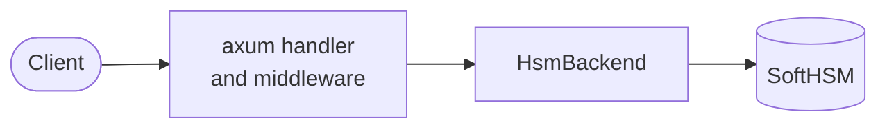
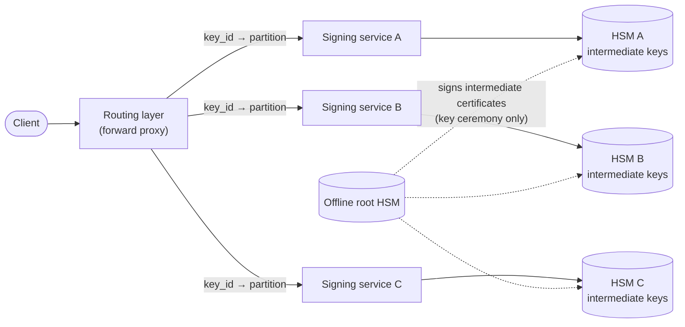

hsm-signing-service
====

An exercise demonstrating how to interface with an HSM service (SoftHSM) and serve signing requests over an API, written in Rust.

## Introduction

This project is a REST service that signs data with a key that stays inside a hardware security module (HSM). A client sends `POST /v1/sign` with a key label and a payload. The HSM signs the payload with the requested algorithm, and the service returns the signature.

### Architecture

A request goes through three layers:



- **axum and middleware:** They own the HTTP endpoints. A middleware does the admission control. An HSM session is a scarce resource, so when too many requests are running or waiting, the middleware rejects new requests at once with `503`. The handlers do not talk to the HSM directly. They use the `HsmBackend` trait.
- **`HsmBackend`:** This trait is the only way to reach the HSM. It has two implementations. One uses a single session. The other uses a pool of sessions, and it is used when you configure a pool size. A request that waits too long for a session gets `504`. The handler tests use a mock backend, so they need no HSM.
- **SoftHSM:** It holds the token and the keys. It does the signing, so the private key never leaves it. A real HSM can replace it, because both use the PKCS#11 interface.

For the component diagram and the sequence diagrams, see [docs/call_flow.md](docs/call_flow.md). For the decision about the limits, see [docs/adrs/001-implemented-max-concurrent-requests.md](docs/adrs/001-implemented-max-concurrent-requests.md). For the load tests, see [Benchmarks](#benchmarks). To run the service in a container, see [Container image](#container-image).

### Concurrency and admission control

An HSM session is a scarce resource, and an HSM call is slow compared to the rest of a request. Two features control how the service uses sessions:

- **Session pool:** Without a pool, the service uses one session, so signing requests are done one at a time. With a pool several requests can be signed at the same time. A bigger pool can raise throughput only if the HSM can do the work in parallel. SoftHSM may not, so measure before you choose a size (see [Benchmarks](#benchmarks)). If all sessions are in use, a request waits for a free one for a short time. After that, it gets `504`.
- **Admission control:** The service accepts only a fixed number of requests at the same time. The limit is the number of sessions plus the queue size. A request over the limit gets `503` with a `Retry-After` header at once, and it never reaches the HSM. With a queue size of `0`, no request waits.

The effect is that the service does not slow down for everyone when the load is too high. Accepted requests wait only a short, bounded time. The excess load is rejected early and cheaply, and the client can try again.

For the details of the decision, see [docs/adrs/001-implemented-max-concurrent-requests.md](docs/adrs/001-implemented-max-concurrent-requests.md).

### Security Approaches

- **Key management:** The HSM makes and keeps every key. `setup.sh` generates the keys inside the token, and we never import a key. The signing key and the AES key are not extractable, so a key never leaves the HSM in plain form. The only export is a demo key that `wrap` outputs encrypted under the AES key. The service finds a key by its label. It has no key rotation, backup or per-key access control (see [Known limitations](#known-limitations)).
- **Secrets:** The service reads the PIN from an environment variable. The code does not log it, and the repository does not hold it.
- **Access:** The endpoint has no authentication. Anyone who can reach it can sign with the keys in the token. The service listens on `127.0.0.1` by default. Keep it on a trusted network.

## Setup

Required tools:

- Homebrew ([https://brew.sh/](https://brew.sh/))
- softhsm2-util ([`brew install softhsm`](https://formulae.brew.sh/formula/softhsm))
- pkcs11-tool ([`brew install opensc`](https://formulae.brew.sh/formula/opensc))

**SoftHSM version:** Use SoftHSM 2.7.0 or later. The `server` signs with the mechanisms in the algorithm table (see [Usage](#usage)), and `verify` uses `CKM_ECDSA_SHA256`. SoftHSM supports the ECDSA mechanisms with hashing, such as `CKM_ECDSA_SHA256`, from 2.7.0 (the release notes say "Added support for ECDSA with hashing"). With an older version, such as 2.6.1 (the version in the Ubuntu package), signing fails with `MechanismInvalid`. To check your version, run `softhsm2-util --version`.

### Environment variables

The setup script and the application itself require certain environment variables to be set.

[direnv](https://direnv.net/) provides a convenient way to manage environment variables per-folder. After installing `direnv`, copy `.envrc.example ` to `.envrc`, then run `direnv allow`.

### `setup.sh`

After installing the required tools and ensuring the environment variables are set, run the provided setup script to create the token and keys:

```sh
sh ./setup.sh
```

## Usage

The program has five commands: `server`, `encrypt`, `decrypt`, `verify` and `wrap`. If you give no command, the program runs `server`.

```sh
cargo run -- --help
```

All commands read their settings from environment variables.

| Command | What it does |
| --- | --- |
| `server` | Starts the HTTP service. It has the endpoint `POST /v1/sign`. |
| `encrypt` | Encrypts data from STDIN with an AES-256-GCM key inside the HSM. |
| `decrypt` | Decrypts the output of `encrypt` inside the HSM. |
| `verify` | Checks an ECDSA signature inside the HSM. |
| `wrap` | Encrypts an EC private key with an AES key inside the HSM. |

For the arguments, the output, the error responses and the exit codes of each command, see [docs/commands.md](docs/commands.md).

```sh
cargo run -- server
curl -X POST http://127.0.0.1:8080/v1/sign \
  -H 'Content-Type: application/json' \
  -d '{"key_id": "example", "algorithm": "ECDSA_P256_SHA256", "payload": "aGVsbG8gd29ybGQ="}'
```

The `algorithm` field chooses the mechanism. The HSM hashes the payload. The key with the label `key_id` must fit the algorithm: the key type, and for ECDSA the curve. If no such key exists, the service answers `422` (the same answer as for an unknown key) and does not sign.

| `algorithm` | Mechanism | Key | Signature |
| --- | --- | --- | --- |
| `ECDSA_P256_SHA256` | `CKM_ECDSA_SHA256` | EC, P-256 | DER |
| `ECDSA_P384_SHA384` | `CKM_ECDSA_SHA384` | EC, P-384 | DER |
| `ECDSA_P521_SHA512` | `CKM_ECDSA_SHA512` | EC, P-521 | DER |
| `RSA_PKCS1_SHA256` | `CKM_SHA256_RSA_PKCS` | RSA (`setup.sh` makes 2048 bits) | Raw bytes, as long as the key modulus |

**Warning:** The endpoint has no authentication. Anyone who can reach it can sign data with the keys in the token. Keep the default address (`127.0.0.1`) unless you add access control.

### Environment variables reference

| Variable | Required | Description |
| --- | --- | --- |
| `HSM_TOKEN_LABEL` | Yes | The label of the SoftHSM token. |
| `HSM_PIN` | Yes | The user PIN of the token. |
| `PKCS11_MODULE` | No | The path to the PKCS#11 library. The default is the Homebrew SoftHSM library. |
| `HSM_SIGNING_SERVICE_HOST` | No | The address to listen on. The default is `127.0.0.1`. |
| `HSM_SIGNING_SERVICE_PORT` | No | The port to listen on. The default is `8080`. |
| `HSM_SIGNING_SERVICE_SHUTDOWN_TIMEOUT_SECS` | No | How many seconds the server waits for running requests after a shutdown signal. Use a whole number of 1 or more. The default is `30`. |
| `HSM_SIGNING_SERVICE_SESSION_POOL_SIZE` | No | How many HSM sessions the server keeps in its session pool. Use a whole number of 1 or more. If you do not set it, the server uses one session and no pool. |
| `HSM_SIGNING_SERVICE_POOL_CONNECTION_TIMEOUT_MS` | No | How many milliseconds a request waits for a free session of the pool. After this time, the server answers `504`. The pool also uses this time to open its sessions at start. Use a whole number of 1 or more. The value `0` is not valid: the server does not start. The default is `500`. Only used with a session pool. |
| `HSM_SIGNING_SERVICE_MAX_QUEUE` | No | How many requests can wait for a free session, in addition to the requests that use a session. The server answers more requests at once with `503` and a `Retry-After` header. Use a whole number of 0 or more. With `0`, no request waits. The default is `20`. |
| `AES_KEY_LABEL` | Setup only | The label of the AES-256 key. `setup.sh` creates it. |
| `EXPORTABLE_KEY_LABEL` | Setup only | The label of the EC P-256 key pair that `wrap` wraps. `setup.sh` creates it. |
| `P384_KEY_LABEL`, `P521_KEY_LABEL`, `RSA_KEY_LABEL` | Setup and tests | The labels of the EC P-384, EC P-521 and RSA 2048 key pairs. `setup.sh` creates them, and the integration tests use them. |

## Container image

The `Dockerfile` builds the service with SoftHSM 2.7.0 (built from source, because the Debian package is too old, see the SoftHSM version in [Setup](#setup)). The commands work with `docker` and with `podman`.

The image has two targets:

| Target | Content | Use |
| --- | --- | --- |
| `runtime` (default) | The service and the SoftHSM library. It runs as user `app` (UID 10001). | Run the service. |
| `setup` | The runtime image, `softhsm2-util`, `pkcs11-tool` and `setup.sh`. | Create the token and keys, once. |

The image holds no token, key or PIN. The token lives in the volume `/var/lib/softhsm/tokens`. You create it with the `setup` image, then the service uses the same volume.

Build both images:

```sh
docker build -t example-hsm-signing-service .
docker build --target setup -t example-hsm-signing-service-setup .
```

Create the token and keys in a named volume. The commands use the environment variables from `.envrc` (see [Environment variables](#environment-variables)). `-e NAME` passes the value from your shell and does not put it on the command line:

```sh
docker volume create example-hsm-tokens
docker run --rm -v example-hsm-tokens:/var/lib/softhsm/tokens \
  -e HSM_TOKEN_LABEL -e AES_KEY_LABEL -e EXPORTABLE_KEY_LABEL \
  -e P384_KEY_LABEL -e P521_KEY_LABEL -e RSA_KEY_LABEL -e HSM_SO_PIN -e HSM_PIN \
  example-hsm-signing-service-setup
```

Run the service on the same volume:

```sh
docker run --rm -p 127.0.0.1:8080:8080 -v example-hsm-tokens:/var/lib/softhsm/tokens \
  -e HSM_TOKEN_LABEL -e HSM_PIN \
  example-hsm-signing-service
```

Then send the request from the [`server`](docs/commands.md#server) section to `http://127.0.0.1:8080/v1/sign`. You can set the other variables of the table above with more `-e` options. The `docker stop` command sends SIGTERM, and the service shuts down gracefully.

Notes:

- The image sets `HSM_SIGNING_SERVICE_HOST=0.0.0.0`, so the port is reachable from outside the container. The endpoint has no authentication. Publish the port only on a trusted interface (`127.0.0.1:` in the command above).
- In a real deployment, give `HSM_PIN` to the container from a secret store (for example a Kubernetes `Secret`), not from a file in the repository. A real HSM replaces the volume: set `PKCS11_MODULE` to the library of the vendor.
- The `setup` image runs `setup.sh`. It stops with an error if a key has wrong settings. It is safe to run again.
- The service has a liveness endpoint, `GET /healthz`, which replies with `HTTP 200` and an empty body when the process serves HTTP. It does not call the HSM, so it does not show that signing works (the service does not replace a session that the HSM closes). It is not limited by `HSM_SIGNING_SERVICE_MAX_QUEUE`, so a busy service still answers it.

## Benchmarks

There are two benchmarks. Both start the compiled service as a child process on a free port. Then they send real `POST /v1/sign` requests over HTTP, with a random payload of 3 to 10 words. They sign with the real SoftHSM token, so they need the token, the key and the environment variables (see [Setup](#setup)). Cargo builds the service with the bench profile (optimized).

For the results of the load tests and the limits of these results, see [docs/benchmarks.md](docs/benchmarks.md).

Load the environment variables first. If you use `direnv`, they are already set. If not, load `.envrc` in a subshell, so the variables do not stay in your shell:

```sh
(set -a; . ./.envrc; set +a; cargo bench --bench custom_benchmark)
```

### `custom_benchmark`

Measures throughput and latency for a number of concurrent callers. Each caller is a thread. It sends requests one after another on its own connection. For each level, a warm-up phase runs first, and its results are thrown away. Then the measured phase runs. The report shows the number of requests, the error rate, the throughput (successful requests per second) and the latency (minimum, p50, p95, p99 and maximum, in milliseconds).

```sh
cargo bench --bench custom_benchmark -- --warmup-secs 5 --duration-secs 30 --seed 42 -C 1 -C 10 -C 100 -C 500
```

| Option | Default | Description |
| --- | --- | --- |
| `--warmup-secs <N>` | `5` | How long the warm-up phase runs, in seconds. |
| `--duration-secs <N>` | `30` | How long the measured phase runs, in seconds. |
| `-C`, `--concurrency <N>` | `1` | The number of concurrent callers, from 1 to 1000. Repeat the option or separate the values with commas to run several levels one after another. `-C 1 -C 10` is the same as `--concurrency 1,10`. |
| `--seed <N>` | none | Seeds the random number generators, so a run can send the same payloads again. Without a seed, every run uses different payloads. |

Notes:

- Each caller sends its next request after the last one ends (a closed loop). When the service is slow, the callers wait, and this hides part of the queueing delay.
- The client and the service run on one machine and share the CPU. SoftHSM is software, so its signing time is not the time of a real HSM.
- Each caller needs a socket, and so does the service. For hundreds of callers, check the limit of open files in your shell (`ulimit -n`). If it is low (the macOS default is often 256), connection errors can look like service errors. Raise the limit before you run the benchmark, for example `ulimit -n 4096`.

### `criterion_benchmark`

Finds regressions. It sends the same requests with one caller and uses [criterion](https://crates.io/crates/criterion) to measure the time of one request and to compare it with an earlier run. The payloads come from a fixed seed, so every run sends the same sequence. A request that fails stops the benchmark.

Save a baseline, change the code, then compare:

```sh
cargo bench --bench criterion_benchmark -- --save-baseline before
cargo bench --bench criterion_benchmark -- --baseline before
```

`criterion` prints the time for each run and tells you if the time changed. It saves the results and an HTML report in `target/criterion`.

## Assumptions

- **Prototype:** The project is a development prototype. It needs a recent SoftHSM (see [Setup](#setup)). A real HSM is assumed to support the mechanisms of the algorithms that you use (for example `CKM_ECDSA_SHA256`) and to work through `PKCS11_MODULE`.
- **Keys:** `key_id` is the label of a private key. Its type and curve must fit the `algorithm` of the request. Labels are unique. The public key has the same label as the private key, so `verify` can find it.
- **Signing:** `payload` is the message, and the HSM hashes it with SHA-256. Signatures are DER-encoded.
- **Network:** The service _MUST_ run on a trusted network.
- **Instances:** With SoftHSM, run one service instance for each token volume. A real HSM may serve many instances.
- **Benchmarks:** The load client and the service run on one machine.
- **Scale:** The load is low and steady. A prototype does not need to scale, so the service runs as a fixed number of instances.

## Known limitations

### Security

- The endpoint has no authentication, authorization, TLS or rate limit for each client. Anyone who can reach it can sign with the keys in the token.
- Any EC private key in the token can be used through the API. There is no list of allowed keys.
- `setup.sh` gives the PIN to `pkcs11-tool` on the command line. Other local users can see it in the process list.
- The demo key `example-exportable` is extractable. It is sensitive, and `wrap` outputs it only in encrypted form.
- There is no key rotation, revocation or backup. The token is the only copy of the keys.

### Behavior

- The service uses only one token, which it finds by its label, and one user PIN.
- The service does not validate `key_id`. An unknown key gives `422`.
- Bad JSON, an unknown algorithm or a wrong content type gets a plain-text error from axum, and not a JSON `{"error": ...}` body.
- The service does not replace a session that the HSM closes. Restart the service to fix this.
- `GET /healthz` shows only that the process answers HTTP. It does not call the HSM. There is no readiness endpoint.
- The `504` timeout covers only the wait for a free session. A started HSM call cannot be cancelled.
- On SIGTERM, running requests finish. If they take longer than `HSM_SIGNING_SERVICE_SHUTDOWN_TIMEOUT_SECS`, the process exits with code 1. No test covers a request that is running during shutdown.
- The service never finalizes the PKCS#11 module, because SoftHSM crashes if it does.

### Performance and testing

- SoftHSM may do signing one call at a time inside the library, so a bigger session pool may not raise throughput. We have not proven where the bottleneck is.
- The service cannot scale itself. It has no metrics endpoint, so an autoscaler has no signal to use. With SoftHSM, you also cannot add instances, because one token volume serves one instance.
- The recorded benchmark (see [docs/benchmarks.md](docs/benchmarks.md)) ran on a busy machine. It does not count `503` and `504` errors separately.
- CI runs only the unit tests and skips the tests that need a token. It does not build the container image.

## Production considerations

This project is a prototype. Before you use the design in production, think about the following points.

### HSM

- **Real HSM:** Replace SoftHSM with a network HSM or a cloud HSM. Set `PKCS11_MODULE` to the library of the vendor. Check that the HSM supports `CKM_ECDSA_SHA256`, and check its limits for clients and sessions.
- **Many instances:** With SoftHSM, run one service instance for each token volume. We assume a network HSM can serve many instances, but we did not test it. The HSM then limits the total throughput, so measure with the real device before you choose the number of instances and the pool size.
- **High availability:** One HSM is a single point of failure. Use a cluster of HSMs with the same keys, or a [federated architecture](#federated-signing-design), and plan how the service reconnects when an HSM or a session fails. The service does not replace a closed session today, so a restart is needed.
- **Reconnect:** The service should recover when an HSM or a session fails, and not need a restart. When a call fails because the session or the token is gone, the service opens a new session, logs in again if needed, and tries the call again. It should try a limited number of times, with a longer wait after each failure, and it stops when the request runs out of time. The service should not try again after a wrong PIN, because failed logins count toward the lockout of the token. If the HSM does not come back in time, the client gets a clear error that it can try again later. The service also reports that it is unavailable through a readiness check, so Kubernetes stops sending traffic to that instance until the HSM is back. The liveness check stays healthy, so Kubernetes does not restart the instance while it reconnects.
- **Keys:** Add a key ceremony with dual control, key backup, rotation and revocation. Today the token is the only copy of the keys. Use a key policy that limits which keys the API can use (see Access).

### Secrets

- **PIN:** Give `HSM_PIN` to the container from a secret store, such as a Kubernetes `Secret`. Do not keep it in a file in the repository.
- **Provisioning:** `setup.sh` gives the PIN to `pkcs11-tool` on the command line, so other users on the same machine can see it for a short time. In production, do the provisioning from a trusted, single-user host or container, or replace the script with a Rust `setup` command that reads the PIN from the environment and never puts it in an argument. Do not run the `setup` image in production.
- **Demo key:** Remove `example-exportable` and the `wrap` demo. No key in production should be extractable.

### Access

- **Authentication and authorization:** The endpoint has none today. Add authentication, such as mutual TLS or tokens, and decide which client may use which key. Put the service behind a gateway or a service mesh, and keep the port on a trusted network.
- **TLS:** The service speaks plain HTTP. End TLS at a proxy, or in the service.
- **Limits for each client:** The admission control limits the total load. Add a limit for each client, so one client cannot use all the places.
- **Audit:** Record who signed what, with which key, and when. Do not log the payload or any secret.

### Operations

- **Health:** `GET /healthz` is a liveness check only. Add a readiness check, for example one that returns `503` when the service rejects requests, and a check that calls the HSM.
- **Shutdown:** Set `HSM_SIGNING_SERVICE_SHUTDOWN_TIMEOUT_SECS` lower than the grace period of the orchestrator, so the service exits with a clear code before it is killed. Test a shutdown with a request in flight.
- **Observability:** Add metrics for the number of sessions in use, the queue length, the `503` and `504` counts, and the signing latency. Add tracing across services.
- **Auto-scaling:** Make the service scale with the traffic. Emit metrics in the Prometheus format (a `/metrics` endpoint) that an autoscaler can use, for example a KEDA `ScaledObject` in Kubernetes. Good signals are the number of requests in the service, the queue length, the rate of `503` answers, and the signing latency. Set a minimum number of instances for availability, and a maximum number that the HSM can serve: the number of instances times the pool size must stay under the session limit of the HSM. Scale up fast and scale down slowly, because a new instance must connect to the HSM and log in before it can serve requests, and a readiness check must tell the autoscaler when it is ready.
- **Tuning:** Set the pool size, the queue size and the pool timeout from a benchmark on the real HSM, from a clean build on a quiet machine. Count `503` and `504` separately.
- **CI:** Run the integration tests and build the container image in CI.
- **Algorithms:** The service supports four algorithms (see [Usage](#usage)). SoftHSM 2.7.0 also supports RSA-PSS and EdDSA (Ed25519). To add one, add a variant to `Algorithm` with its mechanism, key type and signature format, and a key to `setup.sh`.

### Federated signing design

This is a sketch of a design that shows how to grow from one HSM to many without a copy of a key on more than one HSM.

**Key hierarchy**

- **Root key:** One root key signs the certificates of the intermediate keys, and nothing else. It lives in its own HSM, which is offline and used only in a key ceremony. The service never sees it.
- **Intermediate signing keys:** Each intermediate key is generated inside one HSM and is not extractable. The HSM makes a certificate request. Operators sign it with the root key in a key ceremony, which gives an intermediate certificate. We make many intermediate keys and spread them over many HSMs. A key exists in one HSM, so we move no key between HSMs.
- **Verification:** A client checks a signature with the public key of the intermediate certificate, and checks the certificate against the root. Clients trust only the root. We can add, rotate or revoke an intermediate key without a change for the clients.

**Request flow**



- **Signing services:** Each service is the service of this project. It connects to one HSM (or one partition) and serves the keys of that HSM. It stays small and has no knowledge of the other services.
- **Routing layer:** A stateless forward proxy receives every request. It reads the `key_id` and sends the request to the service that holds that key. A table maps each `key_id` to a partition. It comes from configuration or from a registry that the key ceremony updates. You can run many copies of the router.

**What the routing layer does for the services**

- **Authentication and authorization:** The router authenticates the client, for example with mutual TLS, and checks which client may use which `key_id`. The signing services then accept connections only from the router, so they need no authentication of their own.
- **Key validation:** The router must know which keys it can route to which HSM cluster, so it can also check the `key_id`. It rejects a request for an unknown or not routable key at once, with a clear error, and the request never reaches an HSM. It can also reject an unknown or unsupported `algorithm`, and an algorithm that does not match the type of the key (for example an RSA algorithm for an EC key), in the same way. The router can cache the list of keys and the algorithms that each key allows, so these checks need no call to an HSM or to a signing service. For the same reason, it can apply admission control for each key or each HSM cluster (see Load shedding).
- **Admission control:** The router applies a global limit and a limit for each client. Each service keeps its own limit, so one busy HSM does not use up the places of the others.
- **Other jobs:** TLS, audit records, metrics, and a single public address and API.
- **Load shedding:** The router can reject work early, at two levels.
  - **Instance:** The router uses timeouts and a limit for each signing service, so it does not send more requests to an instance that is already overloaded.
  - **Key or HSM:** The router limits the requests for each key or each HSM. When one HSM is overloaded, the router rejects more requests for its keys with `503`, and it does not add load to that HSM. The other HSMs are not affected.

**Control plane**

A control plane could manage the keys and tell the routing layer about them. It is separate from the signing path, so no signing request goes through it.

- **Key management:** It adds, rotates and revokes signing keys. To add a key, it asks an HSM to generate the key, then gets a certificate for it from the root key in a key ceremony. To rotate a key, it adds a new key and then retires the old one. To revoke a key, it marks the key as not usable and publishes the revocation to the clients.
- **Root key:** The root key is offline, so the control plane never connects to it. Adding a key is a manual process. The control plane has an HSM generate the key and a certificate request, and it marks the key as waiting. Operators sign the request with the root key in a key ceremony, with dual control. The control plane then stores the certificate, marks the key as active, and tells the routers. To reduce the work, one ceremony can sign the requests of many keys that were made in advance.
- **Information for the routing layer:** It keeps the list of keys, the HSM cluster of each key, the type of each key and the algorithms that it allows, and the state of each key (for example active, retiring or revoked). It gives this list to the routers, so they route and validate requests from the same data.
- **Availability:** The routers keep working with the last list they got if the control plane is not available. Only changes to keys wait for it. When a key is revoked or unknown and the control plane is not available, a router can remember the "key does not exist" error for a time that you set. Requests for that key then fail fast and do not reach an HSM. The router forgets the error when the time ends, or when the control plane is back and sends the new list of keys.
- **Access:** Only a few trusted operators can use it, and it records every change in an audit log.

**Effects and trade-offs**

- **Scale:** The total throughput is about the sum of the throughput of the HSMs, if the load is spread over many keys. One very busy key still uses one HSM. Measure this on the real devices.
- **Availability:** The loss of an HSM stops the keys on it. The other keys continue to work. To keep one key available, the HSM vendor must replicate it inside an HSM cluster. If you cannot do that, issue several intermediate keys for the same purpose on different HSMs, and let the router choose between them when the policy allows it.
- **Cost:** The design adds one network hop, a new component that must be highly available, and a key-to-partition table that must stay correct. It also needs a key ceremony for the root key and a process to rotate and revoke intermediate keys.
- **Risk:** If the root key is lost, you cannot issue new intermediate keys. If it is stolen, every key is not trusted. Protect it with dual control and backups according to the policy of your organization.
