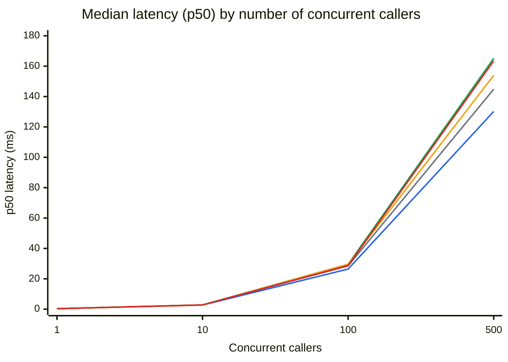
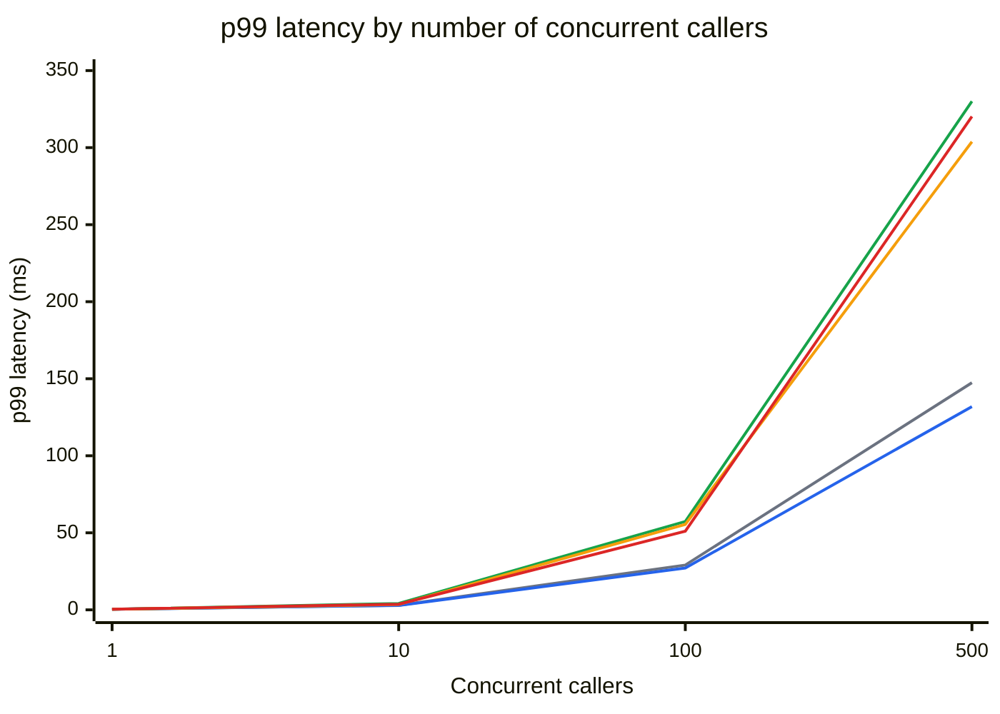
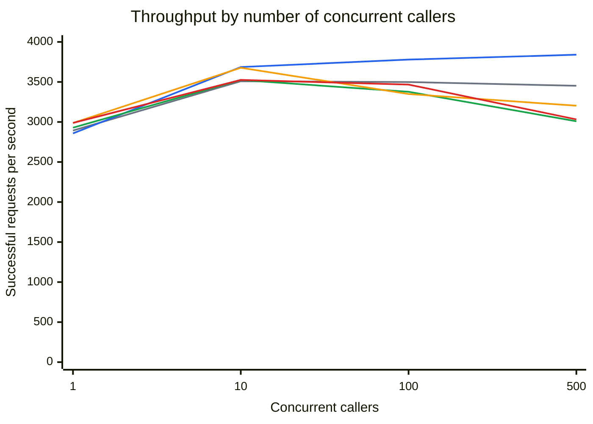
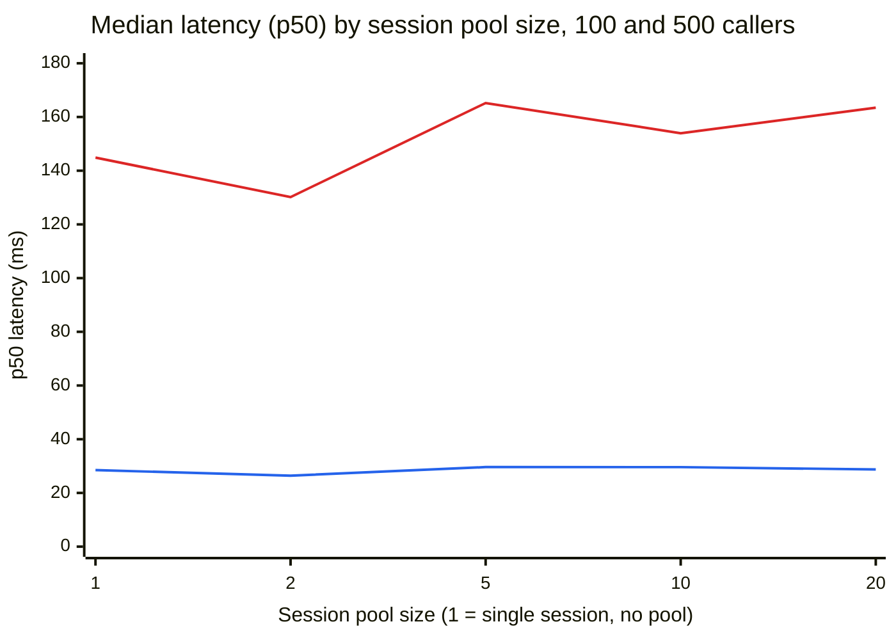
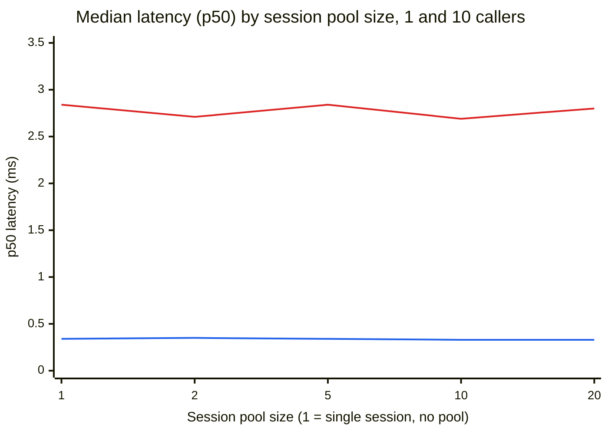
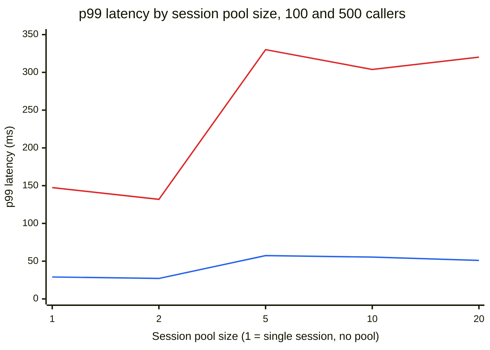
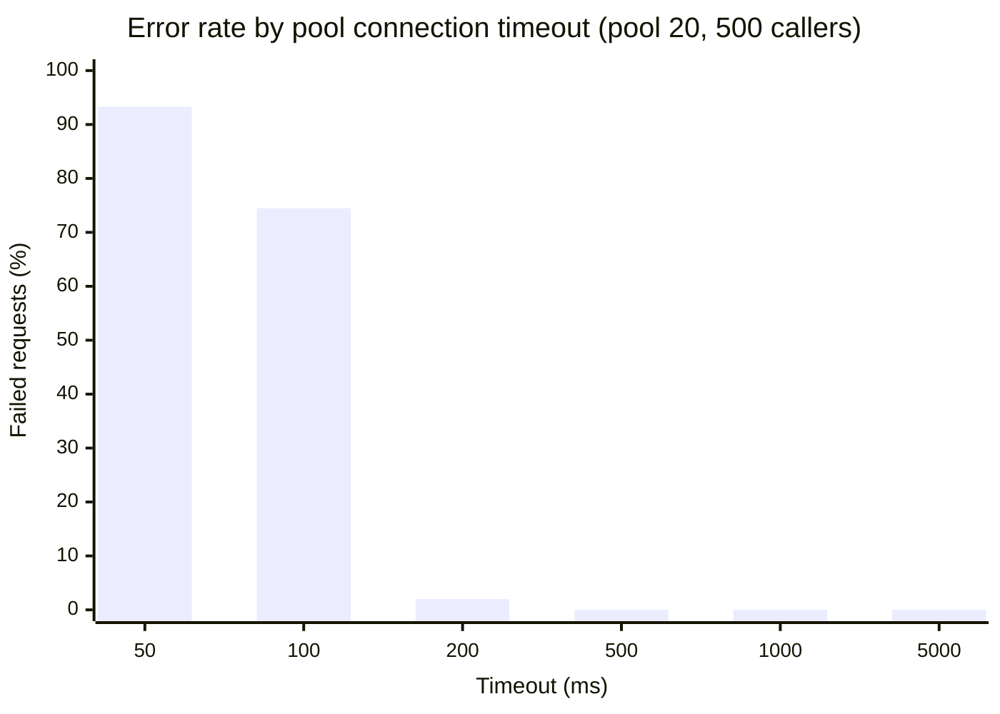
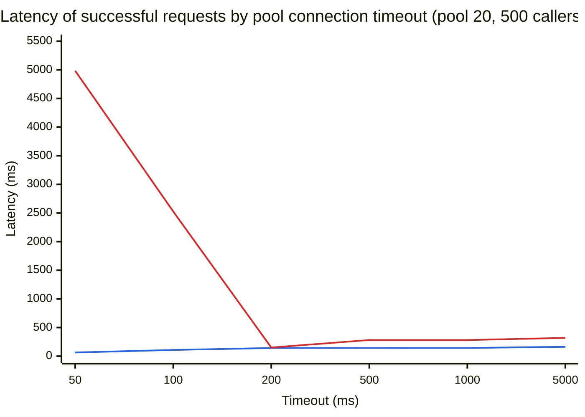
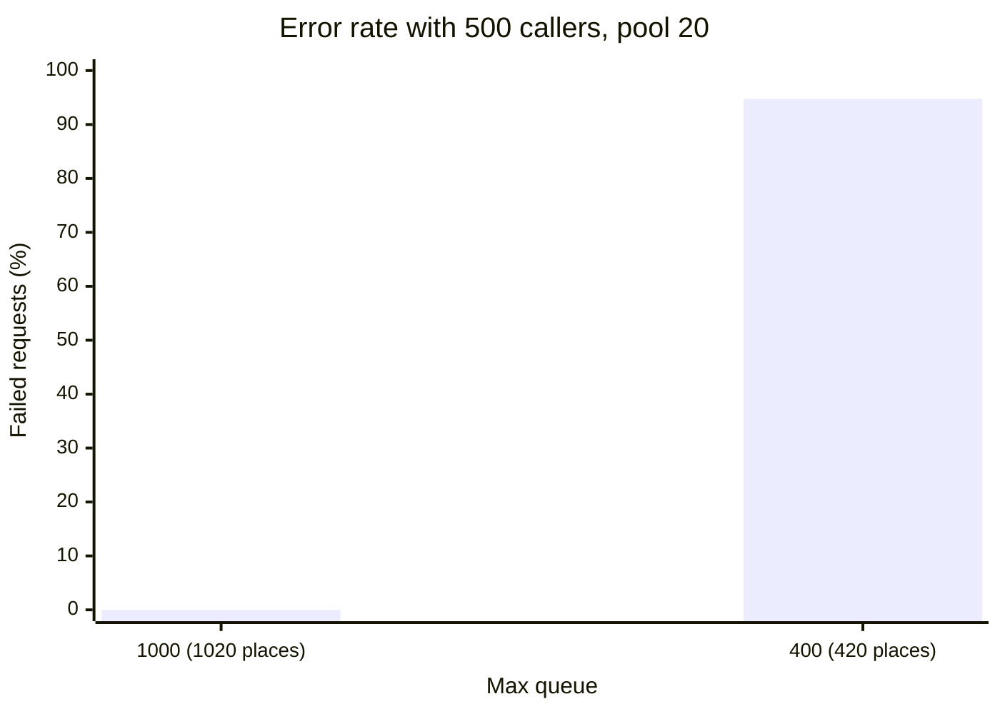

# Benchmarks

This document gives the results of the load tests of `POST /v1/sign`. It shows how latency, throughput and errors change with the number of concurrent callers, the size of the session pool, the pool connection timeout and the queue limit.

**Read the "Limits of these results" section first.** The service and the callers ran on one machine, and each configuration ran once. The run-to-run noise is about 13% or more. Compare the numbers with each other. Do not use them as the maximum speed of the service.

## Summary

- A session pool gives no clear gain in throughput. From 10 callers up, every configuration served 3000 to 3850 requests per second. A pool of 2 sessions was the best in all runs (+5% to +11% against one session), but this is close to the noise of the run. Pools of 5 or more sessions were not better than one session.
- A pool of 5 or more sessions makes the tail longer. At 100 and 500 callers, p99 was about twice as long as with one or two sessions (for example 282 to 330 ms against 132 to 147 ms at 500 callers). This repeated in every run with a pool of 5 or more sessions.
- At 1 caller, the pool changes nothing. All configurations answer in 0.33 to 0.35 ms (median).
- Latency grows in proportion to the number of callers. The callers send the next request as soon as they get an answer, so the median latency is close to *callers ÷ throughput*. At 500 callers, the median is about 130 to 165 ms for every configuration.
- The pool connection timeout decides how many requests fail when the service is overloaded. With 20 sessions and 500 callers, timeouts of 500 ms and 1000 ms caused almost no errors (1 in 103796 requests, and none). A timeout of 200 ms failed 1.99% of the requests, 100 ms failed 74.47%, and 50 ms failed 93.30%.
- With 20 sessions and a queue of 400, the service has 420 places. At 500 callers, the extra callers get `503`. 94.75% of all requests failed in this run (see the note about retries in the section about the queue limit).

## What we measured

| Item | Value |
| --- | --- |
| Endpoint | `POST /v1/sign`, key `example`, algorithm `ECDSA_P256_SHA256` |
| Payload | A random sentence of 3 to 10 words, base64 encoded |
| Tool | `benches/custom_benchmark.rs` (the caller threads use `ureq`) |
| Warm-up | 5 s for each level (not counted) |
| Measured time | 30 s for each level |
| Seed | 42 (the same payloads in every run) |
| Callers | 1, 10, 100 and 500. Each caller sends one request at a time, on its own connection, and sends the next request when it gets the answer. |
| Error | Any answer that is not `200` with a signature, or any failed call. The benchmark does not count `503`, `504` and connection errors separately. |
| Latency | Only requests that succeeded. Time from the start of the request to the end of the response body. |
| Throughput | Successful requests per second |

The benchmark starts its own copy of the service for each configuration, on `127.0.0.1`. The service and the callers run on the same machine, so they use the same CPU cores.

| Machine | Value |
| --- | --- |
| CPU | Apple M5, 10 cores |
| OS | Darwin 27.2.0 |
| HSM | SoftHSM 2.7.0, local token `example` |
| Compiler | rustc 1.99.1, `bench` profile (optimized) |
| Code | commit `3ee2d1f` (no uncommitted changes) |
| Run | 2026-11-16, 11:42 |

### Configurations

| Group | Pool size | Pool connection timeout | Max queue | Callers |
| --- | --- | --- | --- | --- |
| Baseline | none (one session) | not used (no checkout) | 1000 | 1, 10, 100, 500 |
| Pool sizes | 2, 5, 10, 20 | 5000 ms | 1000 | 1, 10, 100, 500 |
| Timeouts | 20 | 500, 1000 ms (asked for), and 200, 100, 50 ms (added) | 1000 | 500 |
| Queue limit | 20 | 5000 ms | 400 | 500 |

- A max queue of 1000 is more than the number of callers, so it never limits the benchmark. A timeout of 5000 ms is longer than any wait in the benchmark.
- The service allows `pool size + max queue` requests at the same time (see [ADR 001](adrs/001-implemented-max-concurrent-requests.md)).
- Each configuration ran once. The timeouts of 200, 100 and 50 ms were not in the request. We added them to show where the errors start.

## Latency and throughput by number of callers

Median latency (p50), in milliseconds:

| Callers | Single session | Pool 2 | Pool 5 | Pool 10 | Pool 20 |
| ---: | ---: | ---: | ---: | ---: | ---: |
| 1 | 0.34 | 0.35 | 0.34 | 0.33 | 0.33 |
| 10 | 2.84 | 2.71 | 2.84 | 2.69 | 2.80 |
| 100 | 28.50 | 26.43 | 29.62 | 29.61 | 28.75 |
| 500 | 144.87 | 130.17 | 165.20 | 153.95 | 163.47 |



Lines (the chart has no legend): ⬜ single session, 🟦 pool 2, 🟩 pool 5, 🟨 pool 10, 🟥 pool 20.

p99 latency, in milliseconds:

| Callers | Single session | Pool 2 | Pool 5 | Pool 10 | Pool 20 |
| ---: | ---: | ---: | ---: | ---: | ---: |
| 1 | 0.36 | 0.37 | 0.36 | 0.35 | 0.37 |
| 10 | 2.95 | 2.84 | 4.14 | 3.47 | 3.67 |
| 100 | 29.08 | 27.13 | 57.38 | 55.43 | 51.04 |
| 500 | 147.44 | 131.88 | 330.06 | 303.83 | 320.17 |



Lines: ⬜ single session, 🟦 pool 2, 🟩 pool 5, 🟨 pool 10, 🟥 pool 20.

Throughput, in successful requests per second:

| Callers | Single session | Pool 2 | Pool 5 | Pool 10 | Pool 20 |
| ---: | ---: | ---: | ---: | ---: | ---: |
| 1 | 2893 | 2857 | 2929 | 2987 | 2988 |
| 10 | 3509 | 3686 | 3524 | 3677 | 3525 |
| 100 | 3499 | 3779 | 3377 | 3349 | 3467 |
| 500 | 3452 | 3840 | 3009 | 3203 | 3032 |



Lines: ⬜ single session, 🟦 pool 2, 🟩 pool 5, 🟨 pool 10, 🟥 pool 20.

What the numbers show:

- **Latency grows with the number of callers because the service is at its limit, not because it is slow for each request.** From 10 callers up, throughput stays flat at 3000 to 3850 requests per second, so extra callers only wait in line. The average latency is about *callers ÷ throughput*. For one session at 500 callers, that is 500 ÷ 3452 = 145 ms, and the median is 145 ms. For a pool of 20 sessions, it is 500 ÷ 3032 = 165 ms, and the median is 163 ms.
- **The pool gives no clear gain in throughput.** Against one session, a pool of 2 gave −1% to +11% (+5% at 10 callers, +8% at 100, +11% at 500). Pools of 5, 10 and 20 gave between −13% and +5%. The run-to-run noise is about 13% (see the limits), so no gap is clearly larger than the noise.
- **At 1 caller, the differences are noise.** One caller never uses more than one session. The values vary from 2857 to 2988 requests per second.
- **The tail gets longer with a pool of 5 or more sessions.** At 100 callers, p99 was 29 ms with one session and 27 ms with two, and 51 to 57 ms with 5 to 20 sessions. At 500 callers, it was 147 ms (one session) and 132 ms (two), and 304 to 330 ms with 5 to 20 sessions. The median changed much less. We did not find the reason. One possible reason is that more threads compete for the same lock, and the wait is then less fair. We did not test this.
- **One session and two sessions gave a very even wait.** With one session at 500 callers, p50 is 145 ms and p99 is 147 ms.

## Latency by pool size

The first point of each line is the single session (no pool).

Median latency (p50), in milliseconds, for 100 and 500 callers:



Lines: 🟦 100 callers, 🟥 500 callers.

Median latency (p50), in milliseconds, for 1 and 10 callers:



Lines: 🟦 1 caller, 🟥 10 callers.

p99 latency, in milliseconds, for 100 and 500 callers:



Lines: 🟦 100 callers, 🟥 500 callers.

What the charts show:

- With 1 or 10 callers, the pool size does not matter. A request waits for no session, or only a short time.
- With 100 and 500 callers, the median is about the same for all pool sizes (26 to 30 ms and 130 to 165 ms). A pool of 2 has the lowest median in both cases, by 7% to 21%, which is close to the noise.
- With 100 and 500 callers, the tail (p99) is about twice as long with a pool of 5 or more sessions.
- The numbers show no reason to use a pool larger than 2 sessions on this machine. More sessions add no throughput, they make the tail longer, and they cost memory and a share of the HSM resources.

## Effect of the pool connection timeout

All runs: pool of 20 sessions, 500 callers, max queue of 1000. The row for 5000 ms is the run from the previous section (no errors). The rows for 50, 100 and 200 ms were added to show where the errors start.

| Timeout (ms) | Requests | Failed | Error rate | Throughput (req/s) | p50 (ms) | p95 (ms) | p99 (ms) |
| ---: | ---: | ---: | ---: | ---: | ---: | ---: | ---: |
| 50 | 136285 | 127148 | 93.30% | 304 | 64.86 | 3710.87 | 4983.35 |
| 100 | 149507 | 111333 | 74.47% | 1268 | 108.60 | 1891.15 | 2526.81 |
| 200 | 106308 | 2119 | 1.99% | 3457 | 142.62 | 148.83 | 150.52 |
| **500** | 103796 | 1 | **0.00%** | 3441 | 143.73 | 155.57 | 282.23 |
| **1000** | 103051 | 0 | **0.00%** | 3419 | 143.10 | 165.22 | 281.22 |
| 5000 | 91439 | 0 | 0.00% | 3032 | 163.47 | 180.12 | 320.17 |





Lines: 🟦 p50, 🟥 p99.

What the numbers show:

- **The two asked-for timeouts cause almost no errors in this run.** At 500 ms, 1 request failed out of 103796. At 1000 ms, none failed. The slowest request without a timeout (5000 ms) took 526 ms, and p99 was 320 ms, so a timeout of 500 ms or more rarely fires at 500 callers.
- **The errors start between 200 ms and 500 ms.** At 200 ms, 1.99% of the requests failed, and the p99 of the successful requests was 151 ms. The pool never makes a request wait longer than the timeout, so the p99 cannot be much more than the timeout.
- **A timeout that is shorter than the normal wait makes the service fail most requests.** At 100 ms and 50 ms, 74% and 93% of the requests failed. The median latency of the successful requests falls (65 ms at 50 ms), because only the requests that got a session at once succeed.
- **The throughput of successful requests falls with a short timeout.** A failed request returns at once, and the caller sends a new one at once. These retries take CPU time from the requests that succeed.
- **The p95 and p99 of 2 to 5 seconds at 100 ms and below are not from the pool.** The pool never makes a request wait more than the timeout. We think the delay is in the connections between the callers and the service (a caller opens a new connection after a failure, and the connection queue of the server can fill up). We did not check this. We also did not check which share of the errors are `504` and which are connection errors.
- **The rows for 500 ms and 1000 ms show the size of the noise.** For these two rows, the timeout almost never fires, so they are the same configuration as the 5000 ms row. The throughput is 3441, 3419 and 3032 requests per second, a spread of about 13%, and p99 is 282, 281 and 320 ms.

## Effect of the queue limit

Pool of 20 sessions, 500 callers, pool connection timeout of 5000 ms. The service has `20 + queue` places. A request that finds no free place gets `503` with `Retry-After: 1`.

| Max queue | Places | Requests | Failed | Error rate | Throughput (req/s) | p50 (ms) | p99 (ms) |
| ---: | ---: | ---: | ---: | ---: | ---: | ---: | ---: |
| 1000 (from the pool run) | 1020 | 91439 | 0 | 0.00% | 3032 | 163.47 | 320.17 |
| **400** | **420** | 154135 | 146049 | **94.75%** | 269 | 1569.89 | 4272.12 |



- With 500 callers and 420 places, at least 80 callers always find the service full. They get `503`, as the design says. With 1020 places, no request failed. With 420 places, most requests failed.
- **The error rate is much higher than 80 ÷ 500 = 16%.** The benchmark has no back-off and ignores `Retry-After`. A caller with a `503` sends a new request at once, so the rejected callers send most of the requests. The error rate counts requests, not callers. In this run, 95% of the requests failed, but the callers that had a place still got an answer.
- The retries also slow the other callers (p50 of 1570 ms, against 163 ms). The same effect appeared with the short timeouts. The load of the callers on the CPU is the most likely cause. We did not test it.
- The benchmark does not count `503` separately. With a timeout of 5000 ms, we expect that the errors are `503`, but we did not check it.

## The bottleneck (not proven)

From 10 callers up, throughput stays at about 3000 to 3850 requests per second, for one session and for pools of 2 to 20 sessions. More sessions do not give more throughput. One caller alone reached about 2900 requests per second, so 10 or more callers add only about 20% to 33%. This is what we expect if a shared resource handles only one signing operation at a time. The likely resource is a lock in SoftHSM or in its PKCS#11 module. We did not sample the process, so this is a guess.

## Limits of these results

- **The machine was not fully quiet.** Before the run, the load average was about 3 to 5 on 10 cores, and the macOS process `appstoreagent` used about 50% of one core. We closed the other applications first, but we did not measure the load during the run. The service and the callers also share the CPU.
- **Each configuration ran once.** The run-to-run noise is about 13% or more. Evidence: the rows for 500 ms and 1000 ms (timeouts that almost never fire) and the pool 20 run are the same configuration, and their throughput differs by about 13% (3419 to 3441, against 3032). At 1 caller, the same code gave 2857 to 2988 requests per second. A difference of less than 13% between two cells is not a result. The comparison of pool sizes for throughput is inside this noise. The doubling of p99 for pools of 5 or more sessions is larger than the noise, and it repeated in every run with such a pool.
- **An earlier run gave other numbers.** A first run on a busy machine (load average about 12, 08:08 on the same day) gave 1254 to 1454 requests per second for one session, and it showed a larger gain for the pool (+6% to +45%). An older run on a quiet machine, before the queue limit existed, gave 4602 to 5952 requests per second for one session (2893 to 3509 in this run). We cannot tell how much of this difference comes from the machine and how much from changes in the code since then. This document replaces the first run.
- **The callers do not back off.** A failed request is followed at once by a new request. This inflates the error rate and the load in the runs with errors.
- **The error counts do not show the cause.** The benchmark counts every failed call as one error type.
- **The callers and the service share the machine,** so the callers take CPU time from the service.
- **One key, one payload size.** The payload is a short sentence. Large payloads would give other results. The benchmark uses only `ECDSA_P256_SHA256`, so it says nothing about the other algorithms.

## Run the benchmarks again

Close other programs first. Then load `.envrc` and run the script:

```sh
(set -a; . ./.envrc; set +a; ruby scripts/run-comprehensive-benchmarks.rb)
```

The script needs about 16 minutes. It writes to `target/bench-results/<MMDDYYhhmm>/`. This run wrote to `target/bench-results/1116261142/`.

| File | Content |
| --- | --- |
| `<run>.txt` | The raw output of the benchmark for one configuration |
| `results.csv`, `results.json` | The parsed numbers for all configurations |
| `metadata.json` | Machine, commit, compiler and settings |

The script has these options: `--warmup-secs N`, `--duration-secs N` and `--dry-run` (it shows the runs and stops).
