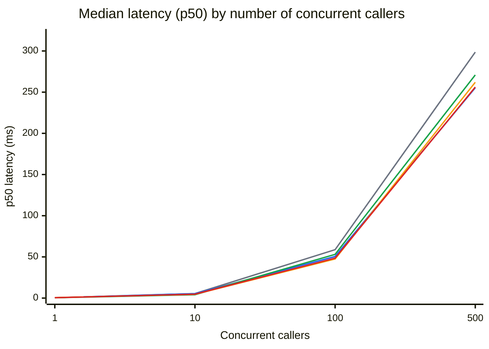
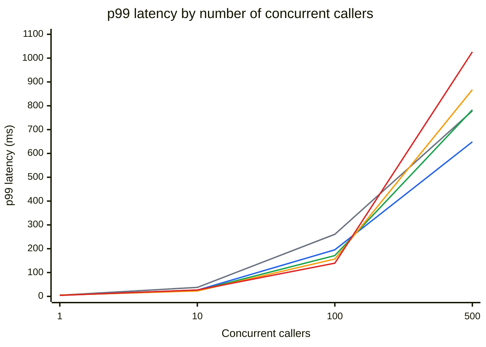
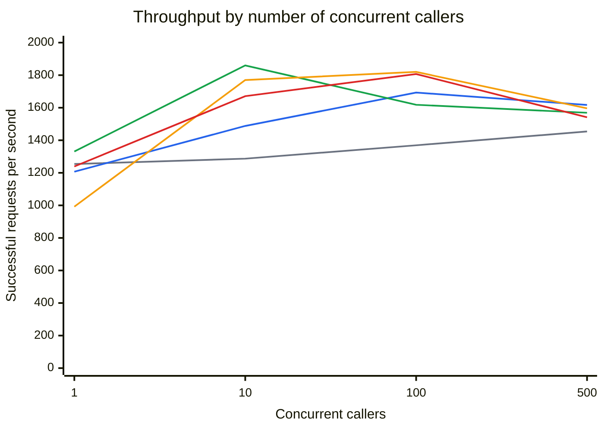
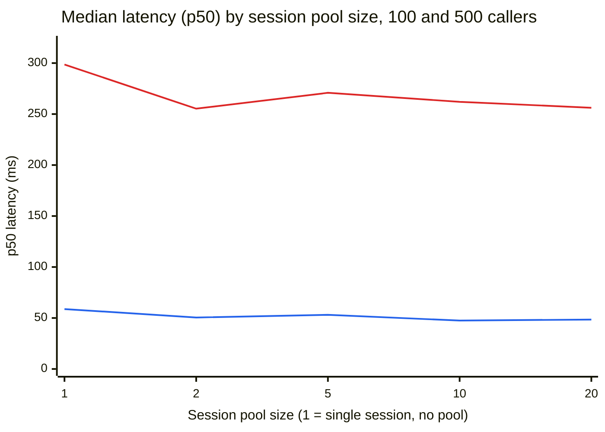
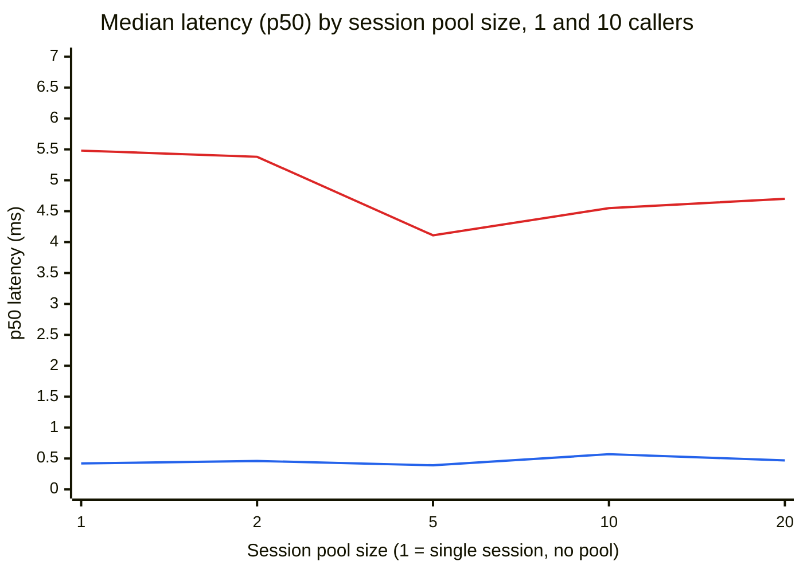
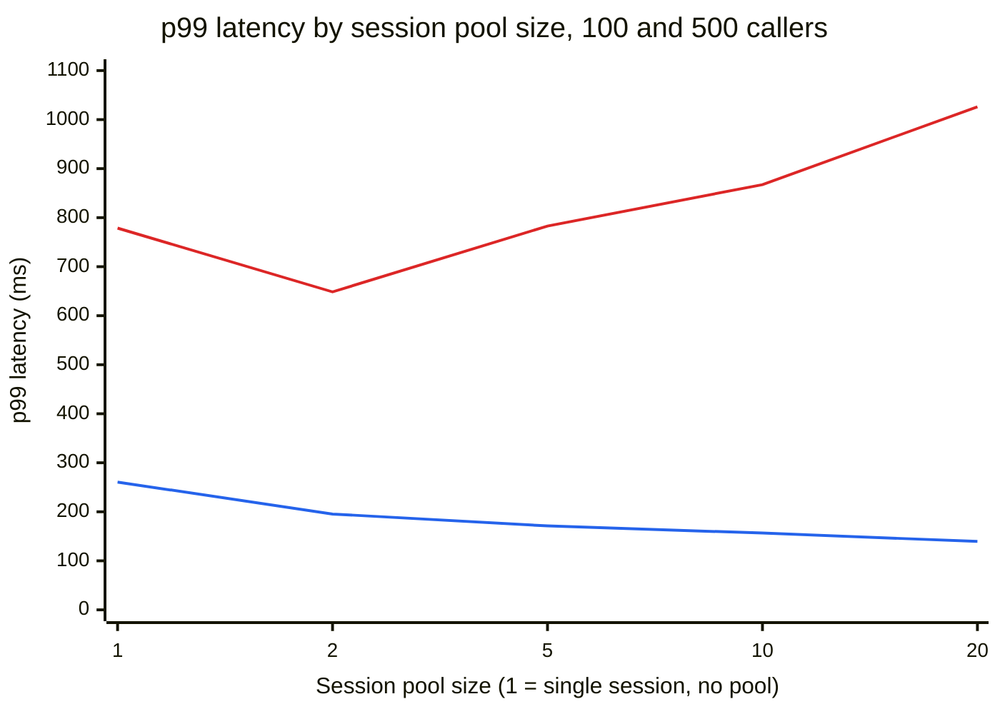
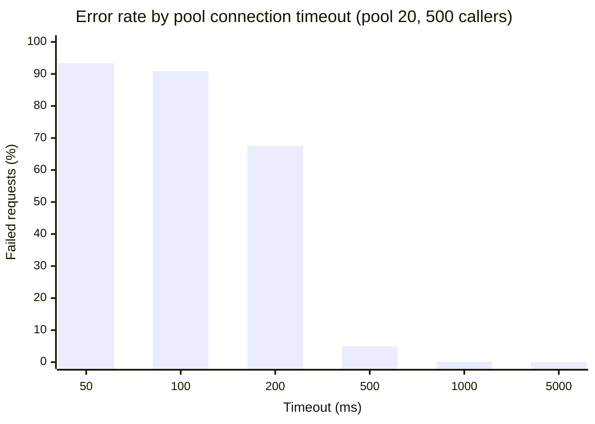
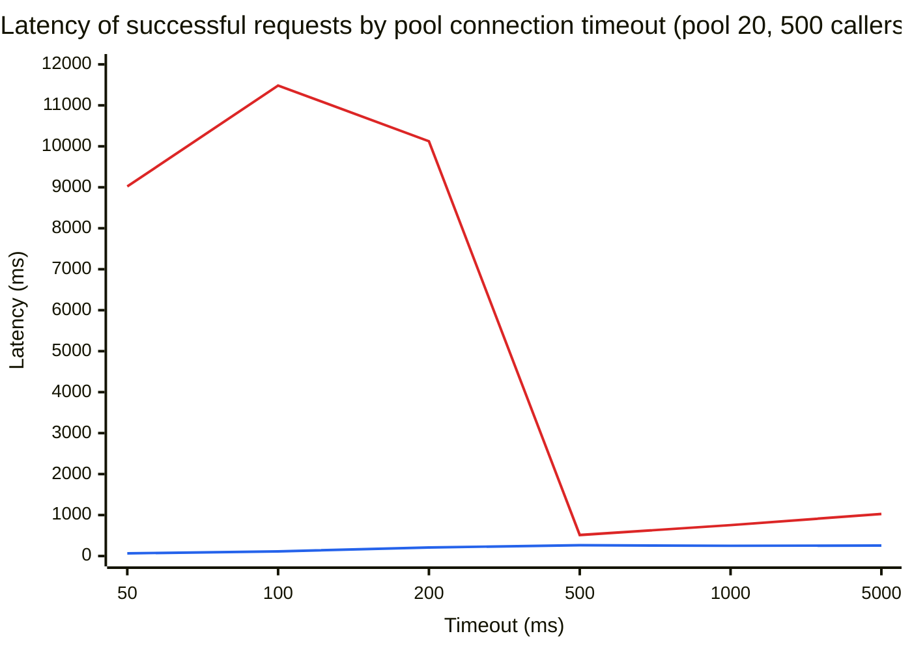
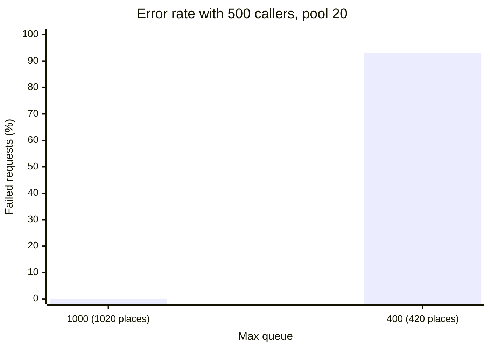

# Benchmarks

This document gives the results of the load tests of `POST /v1/sign`. It shows how latency, throughput and errors change with the number of concurrent callers, the size of the session pool, the pool connection timeout and the queue limit.

**Read the "Limits of these results" section first.** The machine was busy during the run, so the absolute numbers are about 3 to 4 times lower than the numbers of earlier runs on a quiet machine. Compare the numbers with each other. Do not use them as the maximum speed of the service.

## Summary

- A session pool helps only a little. At 10 or more callers, a pool of 2 or more sessions gave 6% to 45% more throughput than one session (the gain was 8% to 11% at 500 callers). A pool of 20 sessions was not clearly better than a pool of 2.
- At 1 caller, the pool changes nothing. All configurations answer in about 0.4 to 0.6 ms (median).
- Latency grows in proportion to the number of callers. The callers send the next request as soon as they get an answer, so the median latency is close to *callers ÷ throughput*. At 500 callers, the median is about 255 to 300 ms for every configuration.
- The pool connection timeout decides how many requests fail when the service is overloaded. With 20 sessions and 500 callers, a timeout of 500 ms failed 4.98% of the requests. A timeout of 1000 ms failed 0.14%. A timeout of 5000 ms failed none.
- With 20 sessions and a queue of 400, the service has 420 places. At 500 callers, the extra callers get `503`. 93% of all requests failed in this run (see the note about retries in the section about the queue limit).

## What we measured

| Item | Value |
| --- | --- |
| Endpoint | `POST /v1/sign`, key `example`, algorithm `ECDSA_P256_SHA256` |
| Payload | A random sentence of 3 to 10 words, base64 encoded |
| Tool | `benches/custom_benchmark.rs` (the caller threads use `ureq`) |
| Warm-up | 5 s for each level (not counted) |
| Measured time | 30 s for each level |
| Seed | 42 (the same payloads in every run) |
| Callers | 1, 10, 100 and 500. Each caller sends one request at a time, on its own connection, and sends the next request when it gets the answer. |
| Error | Any answer that is not `200` with a signature, or any failed call. The benchmark does not count `503`, `504` and connection errors separately. |
| Latency | Only requests that succeeded. Time from the start of the request to the end of the response body. |
| Throughput | Successful requests per second |

The benchmark starts its own copy of the service for each configuration, on `127.0.0.1`. The service and the callers run on the same machine, so they use the same CPU cores.

| Machine | Value |
| --- | --- |
| CPU | Apple M5, 10 cores |
| OS | Darwin 27.2.0 |
| HSM | SoftHSM 2.7.0, local token `example` |
| Compiler | rustc 1.99.1, `bench` profile (optimized) |
| Code | commit `71a56c5` (with uncommitted changes) |
| Run | 2026-11-16, 08:08 |

### Configurations

| Group | Pool size | Pool connection timeout | Max queue | Callers |
| --- | --- | --- | --- | --- |
| Baseline | none (one session) | not used (no checkout) | 1000 | 1, 10, 100, 500 |
| Pool sizes | 2, 5, 10, 20 | 5000 ms | 1000 | 1, 10, 100, 500 |
| Timeouts | 20 | 500, 1000 ms (asked for), and 200, 100, 50 ms (added) | 1000 | 500 |
| Queue limit | 20 | 5000 ms | 400 | 500 |

- A max queue of 1000 is more than the number of callers, so it never limits the benchmark. A timeout of 5000 ms is longer than any wait in the benchmark.
- The service allows `pool size + max queue` requests at the same time (see [ADR 001](adrs/001-implemented-max-concurrent-requests.md)).
- Each configuration ran once. The timeouts of 200, 100 and 50 ms were not in the request. We added them because the two asked-for timeouts show the effect only at their edge.

## Latency and throughput by number of callers

Median latency (p50), in milliseconds:

| Callers | Single session | Pool 2 | Pool 5 | Pool 10 | Pool 20 |
| ---: | ---: | ---: | ---: | ---: | ---: |
| 1 | 0.42 | 0.46 | 0.39 | 0.57 | 0.47 |
| 10 | 5.48 | 5.38 | 4.11 | 4.55 | 4.70 |
| 100 | 58.76 | 50.51 | 53.08 | 47.48 | 48.46 |
| 500 | 298.64 | 255.29 | 270.86 | 262.00 | 256.21 |



Lines (the chart has no legend): ⬜ single session, 🟦 pool 2, 🟩 pool 5, 🟨 pool 10, 🟥 pool 20.

p99 latency, in milliseconds:

| Callers | Single session | Pool 2 | Pool 5 | Pool 10 | Pool 20 |
| ---: | ---: | ---: | ---: | ---: | ---: |
| 1 | 4.97 | 4.94 | 5.08 | 5.24 | 4.29 |
| 10 | 37.64 | 26.02 | 24.29 | 22.74 | 26.67 |
| 100 | 260.56 | 195.47 | 171.23 | 156.60 | 139.48 |
| 500 | 778.63 | 648.62 | 782.92 | 867.34 | 1026.19 |



Lines: ⬜ single session, 🟦 pool 2, 🟩 pool 5, 🟨 pool 10, 🟥 pool 20.

Throughput, in successful requests per second:

| Callers | Single session | Pool 2 | Pool 5 | Pool 10 | Pool 20 |
| ---: | ---: | ---: | ---: | ---: | ---: |
| 1 | 1254 | 1207 | 1331 | 992 | 1239 |
| 10 | 1287 | 1488 | 1860 | 1770 | 1671 |
| 100 | 1369 | 1693 | 1618 | 1820 | 1807 |
| 500 | 1454 | 1617 | 1569 | 1596 | 1541 |



Lines: ⬜ single session, 🟦 pool 2, 🟩 pool 5, 🟨 pool 10, 🟥 pool 20.

What the numbers show:

- **Latency grows with the number of callers because the service is at its limit, not because it is slow for each request.** From 10 callers up, throughput stays flat at 1300 to 1900 requests per second, so extra callers only wait in line. The average latency is about *callers ÷ throughput*. For a pool of 20 sessions at 500 callers, that is 500 ÷ 1541 = 325 ms. The median is 256 ms, and p99 is 1026 ms.
- **The pool gives a small gain.** At 100 callers, throughput rose from 1369 (one session) to 1693 to 1820 (pools of 2 to 20). That is +18% to +33%. At 10 callers, the gain was +16% to +45%. At 500 callers, it was +6% to +11%.
- **At 1 caller, the differences are noise.** One caller never uses more than one session. The values vary from 992 to 1331 requests per second.
- **The tail at 100 callers improves with the pool size.** p99 went from 261 ms (one session) to 195, 171, 157 and 139 ms.
- **The tail at 500 callers gets worse with the pool size.** p99 went from 649 ms (pool 2) to 1026 ms (pool 20). We did not find the reason. One possible reason is that more threads compete for the same lock, and the wait is then less fair. We did not test this.

## Latency by pool size

The first point of each line is the single session (no pool).

Median latency (p50), in milliseconds, for 100 and 500 callers:



Lines: 🟦 100 callers, 🟥 500 callers.

Median latency (p50), in milliseconds, for 1 and 10 callers:



Lines: 🟦 1 caller, 🟥 10 callers.

p99 latency, in milliseconds, for 100 and 500 callers:



Lines: 🟦 100 callers, 🟥 500 callers.

What the charts show:

- With 1 or 10 callers, the pool size does not matter. A request waits for no session, or only a short time.
- With 100 callers, the median improves by about 10% to 19% when a pool is used (this is close to the noise of the run). The tail (p99) improves with every step.
- With 500 callers, the median is about the same for all pool sizes (255 to 271 ms), and the tail gets worse for larger pools.
- The numbers show no reason to use a pool larger than 2 to 5 sessions on this machine. More sessions add no throughput, and they cost memory and a share of the HSM resources.

## Effect of the pool connection timeout

All runs: pool of 20 sessions, 500 callers, max queue of 1000. The row for 5000 ms is the run from the previous section (no errors). The rows for 50, 100 and 200 ms were added to show the effect more clearly.

| Timeout (ms) | Requests | Failed | Error rate | Throughput (req/s) | p50 (ms) | p95 (ms) | p99 (ms) |
| ---: | ---: | ---: | ---: | ---: | ---: | ---: | ---: |
| 50 | 74243 | 69277 | 93.31% | 164 | 66.02 | 5542.36 | 9020.31 |
| 100 | 83003 | 75477 | 90.93% | 250 | 112.75 | 1722.82 | 11482.82 |
| 200 | 78105 | 52733 | 67.52% | 844 | 209.17 | 847.20 | 10123.28 |
| **500** | 53206 | 2648 | **4.98%** | 1672 | 263.18 | 456.64 | 513.06 |
| **1000** | 51870 | 72 | **0.14%** | 1699 | 250.35 | 516.61 | 754.43 |
| 5000 | 46564 | 0 | 0.00% | 1541 | 256.21 | 655.16 | 1026.19 |





Lines: 🟦 p50, 🟥 p99.

What the numbers show:

- **The two asked-for timeouts do cause errors.** At 500 ms, 4.98% of the requests failed. At 1000 ms, 0.14% failed. The wait for a session is long enough in a few cases at 500 callers (p99 is 1026 ms without a timeout).
- **A timeout cuts the latency of the successful requests.** With a timeout of 500 ms, p99 is 513 ms, and it cannot be much more than the timeout. Without a timeout (5000 ms), it is 1026 ms. The requests that would wait longest fail instead of waiting.
- **A timeout that is shorter than the normal wait makes the service fail most requests.** From 200 ms down, more than half of the requests failed. The median latency of the successful requests falls (66 ms at 50 ms), because only the requests that got a session at once succeed.
- **The throughput of successful requests falls with a short timeout.** A failed request returns at once, and the caller sends a new one at once. These retries take CPU time from the requests that succeed.
- **The p95 and p99 of 5 to 11 seconds at 200 ms and below are not from the pool.** The pool never makes a request wait more than the timeout. We think the delay is in the connections between the callers and the service (a caller opens a new connection after a failure, and the connection queue of the server can fill up). We did not check this. We also did not check which share of the errors are `504` and which are connection errors.

## Effect of the queue limit

Pool of 20 sessions, 500 callers, pool connection timeout of 5000 ms. The service has `20 + queue` places. A request that finds no free place gets `503` with `Retry-After: 1`.

| Max queue | Places | Requests | Failed | Error rate | Throughput (req/s) | p50 (ms) | p99 (ms) |
| ---: | ---: | ---: | ---: | ---: | ---: | ---: | ---: |
| 1000 (from the pool run) | 1020 | 46564 | 0 | 0.00% | 1541 | 256.21 | 1026.19 |
| **400** | **420** | 85642 | 79662 | **93.02%** | 197 | 1954.00 | 8687.14 |



- With 500 callers and 420 places, at least 80 callers always find the service full. They get `503`, as the design says. With 1020 places, no request failed. With 420 places, most requests failed.
- **The error rate is much higher than 80 ÷ 500 = 16%.** The benchmark has no back-off and ignores `Retry-After`. A caller with a `503` sends a new request at once, so the rejected callers send most of the requests. The error rate counts requests, not callers. In this run, 93% of the requests failed, but the callers that had a place still got an answer.
- The retries also slow the other callers (p50 of 1954 ms, against 256 ms). The same effect appeared with the short timeouts. The load of the callers on the CPU is the most likely cause. We did not test it.
- The benchmark does not count `503` separately. With a timeout of 5000 ms, we expect that the errors are `503`, but we did not check it.

## The bottleneck (not proven)

Throughput stays at about 1300 to 1900 requests per second from 10 callers up, for one session and for pools of 2 to 20 sessions. More sessions do not give more throughput. This is what we expect if a shared resource handles only one signing operation at a time. The likely resource is a lock in SoftHSM or in its PKCS#11 module. We did not sample the process, so this is a guess.

The cost of one sign request, one caller at a time, was 215 µs (Criterion, earlier run on a quiet machine). That is about 4600 requests per second, which matches the earlier run with one caller (see below). Under load, the service gave about 1200 to 1900 requests per second.

## Limits of these results

- **The machine was busy.** The load average was about 12 on 10 cores before and after the run. Firefox used about 180% of one CPU core, and other programs used CPU as well. The service and the callers also share the CPU. An earlier run on a quiet machine (before the queue limit was added, 5 s warm-up and 30 s measuring, one session) gave 4602, 5952, 5850 and 5765 requests per second at 1, 10, 100 and 500 callers. The same configuration gave 1254, 1287, 1369 and 1454 in this run. Run the script again on a quiet machine before you use the absolute numbers.
- **Each configuration ran once.** The run-to-run noise is about 20% or more on this machine. An example: at 1 caller, the same code gave 992 to 1331 requests per second. A difference of less than 20% between two cells is not a result. The pool size comparison for throughput is inside this noise, except for the gap between one session and a pool at 10 or more callers.
- **The callers do not back off.** A failed request is followed at once by a new request. This inflates the error rate and the load in the runs with errors.
- **The error counts do not show the cause.** The benchmark counts every failed call as one error type.
- **The callers and the service share the machine,** so the callers take CPU time from the service.
- **One key, one payload size.** The payload is a short sentence. Large payloads would give other results.

## Run the benchmarks again

Close other programs first. Then load `.envrc` and run the script:

```sh
(set -a; . ./.envrc; set +a; scripts/run-comprehensive-benchmarks)
```

The script needs about 16 minutes. It writes to `target/bench-results/<MMDDYYhhmm>/`. This run wrote to `target/bench-results/1116260808/`.

| File | Content |
| --- | --- |
| `<run>.txt` | The raw output of the benchmark for one configuration |
| `results.csv`, `results.json` | The parsed numbers for all configurations |
| `metadata.json` | Machine, commit, compiler and settings |

The script has these options: `--warmup-secs N`, `--duration-secs N` and `--dry-run` (it shows the runs and stops).
