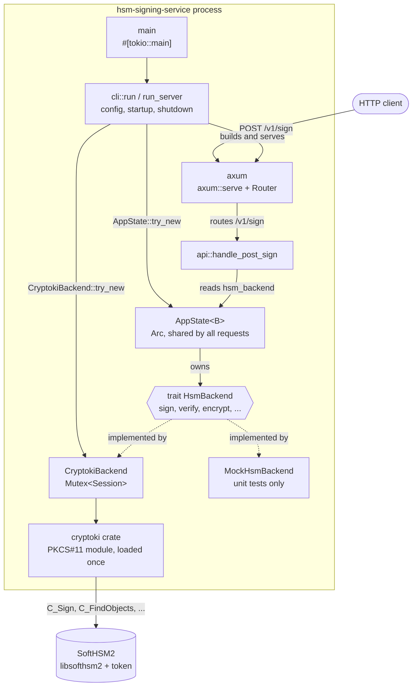
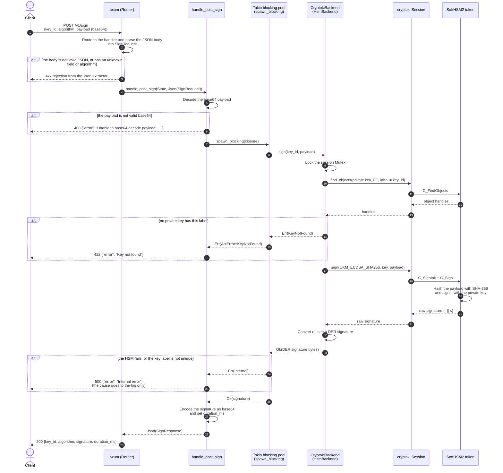

# Call flow

This document shows how the parts of the service work together and how the service handles a `POST /v1/sign` request.

## Components

`main` starts the Tokio runtime and calls `cli::run`. For the `server` command, `cli::run_server` loads the configuration, connects to the HSM, builds the router and starts `axum`. The handler uses the `HsmBackend` trait and does not know the implementation. In production, the implementation is `CryptokiBackend`. In unit tests, it is `MockHsmBackend`.

## Sign request

The HSM calls are blocking, so the handler runs them with `tokio::task::spawn_blocking`. This keeps the async worker threads free. `CryptokiBackend` has one logged-in session behind a `Mutex`, so the HSM calls of concurrent requests run one at a time.

The private key never leaves the HSM. The HSM hashes the payload with SHA-256 and signs it (`CKM_ECDSA_SHA256`). It returns the signature as raw `r || s`. `CryptokiBackend` converts it to DER form.

## Startup and shutdown

- `run_server` stops with exit code 1 if the configuration is not valid, if the HSM token is not found, or if the login fails. Because of this, the service never starts without a working HSM connection.
- On SIGINT or SIGTERM, `axum` stops accepting new connections and waits for the running requests. If they are still running after `HSM_SIGNING_SERVICE_SHUTDOWN_TIMEOUT_SECS` seconds, the process exits with code 1.
