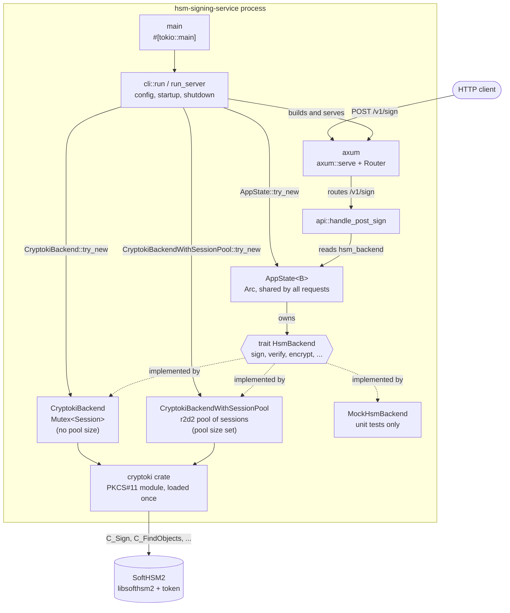
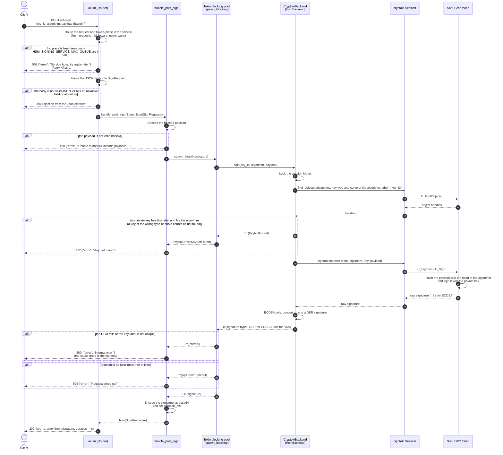
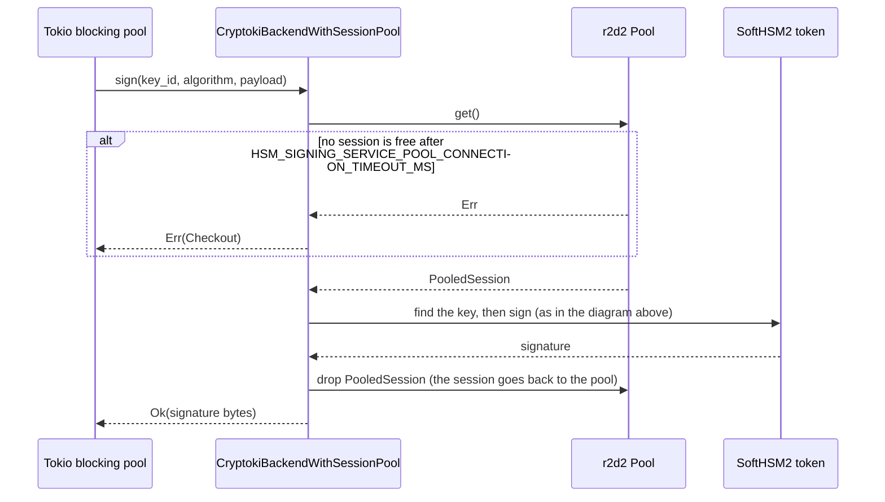

# Call flow

This document shows how the parts of the service work together and how the service handles a `POST /v1/sign` request.

## Components

`main` starts the Tokio runtime and calls `cli::run`. For the `server` command, `cli::run_server` loads the configuration, connects to the HSM, builds the router and starts `axum`. The handler uses the `HsmBackend` trait and does not know the implementation. In production, there are two implementations. `run_server` chooses one at startup:

- `CryptokiBackendWithSessionPool` is used when `HSM_SIGNING_SERVICE_SESSION_POOL_SIZE` is set. It has a pool of sessions (from `r2d2`), so several HSM calls can run at the same time.
- `CryptokiBackend` is used when that variable is not set. It has one session behind a `Mutex`.

In unit tests, the implementation is `MockHsmBackend`.

The `Algorithm` enum (`src/algorithm.rs`) says what each algorithm needs from the HSM: the PKCS#11 mechanism, the key type, for ECDSA the curve, and the size of `r` and `s`. The request field `algorithm` is passed to the backend.

The router has a middleware that limits how many requests are in the service at the same time (see "Queue limit" below).

## Queue limit

The service has a limit for the requests that are in the handler at the same time. It is the number of sessions (`HSM_SIGNING_SERVICE_SESSION_POOL_SIZE`, or 1 without a pool) plus `HSM_SIGNING_SERVICE_MAX_QUEUE` (the default is 20). `api::router` applies the limit with the `api::limit_requests` middleware. It keeps a Tokio `Semaphore` and takes one place with `try_acquire` for each request, so it never waits.

- The middleware runs before the handler. A request over the limit is rejected before the service reads its JSON body.
- The middleware is also the place for other checks that must run before the handler.
- If no place is free, the service returns `503` with a `Retry-After: 1` header. The request does not reach the HSM.
- The place is free again when the response is ready, for a success and for an error.
- With `HSM_SIGNING_SERVICE_MAX_QUEUE=0`, no request waits: the service rejects a request when all sessions are in use.

## Sign request

The HSM calls are blocking, so the handler runs them with `tokio::task::spawn_blocking`. This keeps the async worker threads free. The number of HSM calls that run at the same time depends on the backend:

- `CryptokiBackend` has one logged-in session behind a `Mutex`, so the HSM calls of concurrent requests run one at a time.
- `CryptokiBackendWithSessionPool` takes a session from the pool for each call and gives it back when the call ends. Up to `HSM_SIGNING_SERVICE_SESSION_POOL_SIZE` calls run at the same time. If all sessions are in use, the call waits for a free session for up to `HSM_SIGNING_SERVICE_POOL_CONNECTION_TIMEOUT_MS` milliseconds (the default is 500). After that, it fails with a checkout error, and the handler returns `504`.

The diagram shows `CryptokiBackend`. `CryptokiBackendWithSessionPool` follows the same steps. The only difference is how it gets a session (see the note after the diagram).

The private key never leaves the HSM. The HSM hashes the payload with the hash of the algorithm and signs it (for example `CKM_ECDSA_SHA256` for `ECDSA_P256_SHA256`). For ECDSA, it returns the signature as raw `r || s`, and the backend converts it to DER form. For RSA, the signature is returned as raw bytes.

### Session handling with `CryptokiBackendWithSessionPool`

In the diagram, step "Lock the session Mutex" is replaced by "take a session from the pool". The other steps are the same.

`sign_blocking` maps a checkout error to `ApiError::Timeout`, so the handler returns `504 {"error": "Request timed out"}`. A client can try again later. The queue limit keeps the number of waiting requests small, so a request waits at most for the pool connection timeout.

## Startup and shutdown

- `run_server` stops with exit code 1 if the configuration is not valid, if the HSM token is not found, or if the login fails. Because of this, the service never starts without a working HSM connection.
- With `CryptokiBackendWithSessionPool`, `try_new` logs in once, with one session that stays open for the life of the process. PKCS#11 login belongs to the token, so every session of the pool is then logged in. The pool never logs in itself, because a wrong PIN would be tried again and again, and each failed login counts toward the lockout of the token. Then `try_new` opens all the sessions of the pool (read-only). It fails, and the process exits with code 1, if the pool cannot open all of them. The pool never closes a session because of its age or because it is idle.
- On SIGINT or SIGTERM, `axum` stops accepting new connections and waits for the running requests. If they are still running after `HSM_SIGNING_SERVICE_SHUTDOWN_TIMEOUT_SECS` seconds, the process exits with code 1.
